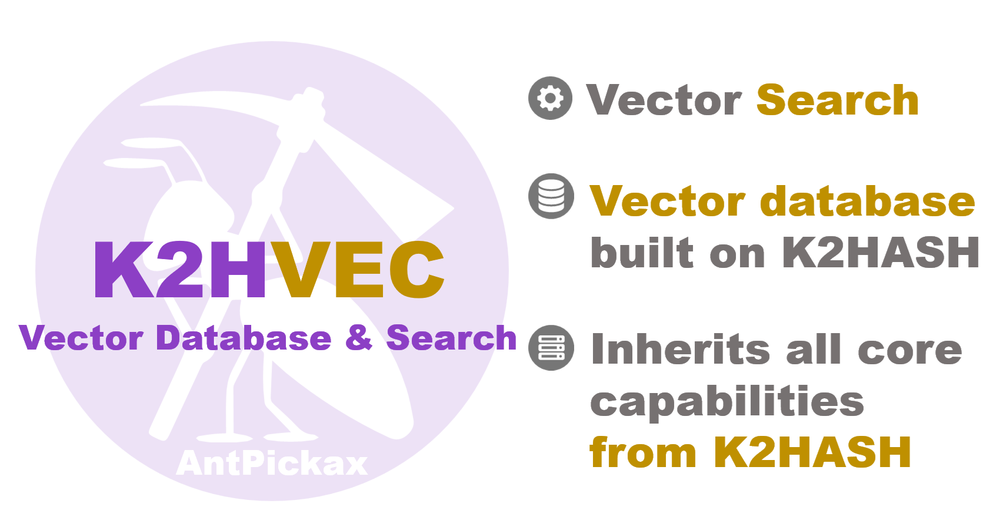

# **K2HVEC**
**K2HVEC** は、Key-Value Store（KVS）ライブラリ [K2HASH](https://github.com/yahoojapan/k2hash) を基盤として構築された、高性能なKVSベースのベクトルデータベースです。  
AIや機械学習モデルによって生成されたベクトル埋め込み（浮動小数点数の配列）をキーとして任意のデータを格納し、高速かつ高精度なベクトル類似度検索を実現します。
**K2HVEC** は、LINEヤフー株式会社がオープンソースとして公開するプロダクト [AntPickax](https://antpick.ax/indexja.html) のひとつです。  

## {{ page.arrow_link_overview }}
**K2HVEC** の[概要](homeja.html)について説明します。  

## {{ page.arrow_link_feature }}
**K2HVEC** の[特徴](featureja.html)について詳しく説明します。  

## {{ page.arrow_link_usage }}
**K2HVEC** をプログラムに組み込むための[使い方](usageja.html)について説明します。  

## {{ page.arrow_link_build }}
**K2HVEC** をGithubの[ソースコード]({{ site.github.repository_url }})から[ビルド](buildja.html)する方法を説明します。

## {{ page.arrow_link_developer }}
**K2HVEC** が提供する[開発者](developerja.html)向けのプログラミングインターフェースを説明します。

## {{ page.arrow_link_environments }}
**K2HVEC** がロードする[環境変数](environmentsja.html)について説明します。

## {{ page.arrow_link_tools }}
**K2HVEC** が提供する[ツール](toolsja.html)の一覧およびそれらを説明します。

# **AntPickaxについて**
[AntPickax](https://antpick.ax/indexja.html)は、LINEヤフー株式会社がオープンソースとして公開する一連のプロダクト群です。  
詳細は、[AntPickax](https://antpick.ax/indexja.html) を参照してください。
